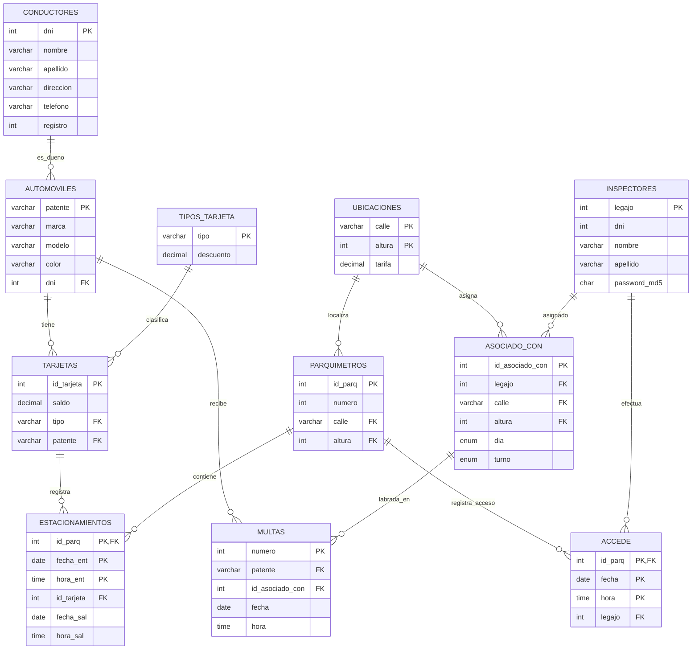
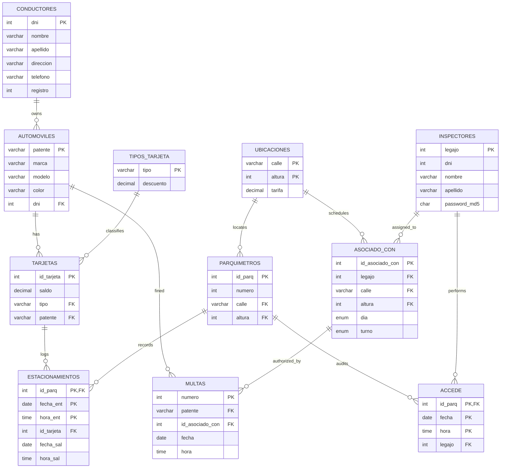
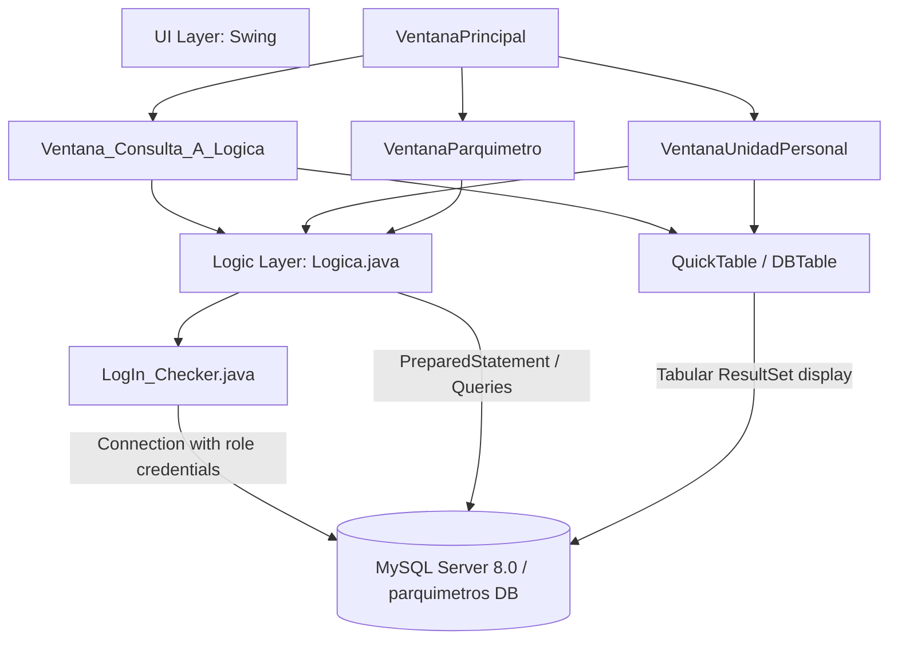

# Sistema de Gestión de Parquímetros / Parking Meter Management System

*Repositorio correspondiente al Proyecto N° 2 y N° 3 de la cátedra **Bases de Datos** (2do Cuatrimestre de 2020)*  
*Departamento de Ciencias e Ingeniería de la Computación — **Universidad Nacional del Sur (UNS)**, Bahía Blanca, Argentina.*  

**Autores / Authors:**  
- Bruno Velazquez  
- Rodrigo Kraus  

---

## Índice / Table of Contents
- [Español](#español)
  - [1. Descripción General](#1-descripción-general)
  - [2. Estructura del Repositorio](#2-estructura-del-repositorio)
  - [3. Modelo de Datos y Esquema Relacional](#3-modelo-de-datos-y-esquema-relacional)
  - [4. Esquema de Usuarios y Seguridad MySQL](#4-esquema-de-usuarios-y-seguridad-mysql)
  - [5. Procedimientos, Triggers y Extensiones (Proyecto 3)](#5-procedimientos-triggers-y-extensiones-proyecto-3)
  - [6. Arquitectura de la Aplicación Java](#6-arquitectura-de-la-aplicación-java)
  - [7. Reglas de Negocio y Lógica de Inspección](#7-reglas-de-negocio-y-lógica-de-inspección)
  - [8. Requisitos y Guía de Ejecución](#8-requisitos-y-guía-de-ejecución)
- [English](#english)
  - [1. Overview](#1-overview)
  - [2. Repository Structure](#2-repository-structure)
  - [3. Data Model & Relational Schema](#3-data-model--relational-schema)
  - [4. MySQL Users & Security Matrix](#4-mysql-users--security-matrix)
  - [5. Stored Procedures, Triggers & Extensions (Project 3)](#5-stored-procedures-triggers--extensions-project-3)
  - [6. Java Application Architecture](#6-java-application-architecture)
  - [7. Business Rules & Inspection Logic](#7-business-rules--inspection-logic)
  - [8. Requirements & Setup Guide](#8-requirements--setup-guide)

---

# Español

## 1. Descripción General

El presente proyecto implementa un sistema integral para la gestión y fiscalización de estacionamiento medido urbano. El sistema abarca:
1. **Base de Datos Relacional (`parquimetros`)**: Diseño e implementación normalizada en MySQL/InnoDB con restricciones de integridad referencial, vistas operativas, funciones de hash criptográfico y asignación de privilegios según el principio de mínimo privilegio.
2. **Aplicación de Escritorio en Java**: Interfaz gráfica (Swing + QuickTable) conectada mediante JDBC que simula tres perfiles operacionales:
   - **Administrador**: Consola de consultas SQL arbitrarias con introspección interactiva del catálogo de datos (`SHOW TABLES`, `DESCRIBE`).
   - **Inspector (Unidad Personal Móvil)**: Simulación de terminal móvil portátil para recorrer calles, cargar patentes detectadas, conectar la unidad al parquímetro, registrar accesos y labrar multas automáticas a infractores.
   - **Parquímetro (Simulación de Conexión)**: Apertura y cierre de estacionamientos con descuento por tipo de tarjeta y cálculo automático de saldos y tiempos.

---

## 2. Estructura del Repositorio

```text
Proyecto-Nro2-BD2020/
├── Ejercicio 1/                                   # Entrega de Base de Datos y Scripts SQL
│   ├── parquimetros.sql                           # DDL: creación de base de datos, tablas, vistas y usuarios
│   ├── datos.sql                                  # DML: dataset inicial básico de prueba
│   ├── datos_cate.sql                             # DML: dataset provisto por la cátedra para evaluación
│   ├── borrar.sql                                 # Script de limpieza rápida de base de datos y usuarios
│   ├── Traza.xlsx                                 # Planilla de trazabilidad de pruebas
│   ├── Correcciones - P2E1 - Kraus - Velazquez.txt# Feedback de corrección del Ejercicio 1
│   └── Correcciones - P2E2 - Kraus - Velazquez.txt# Feedback de corrección del Ejercicio 2
├── Ejercicio2/                                    # Proyecto Java (Eclipse / Maven compatible)
│   ├── .project, .classpath, .settings/          # Configuración del entorno Eclipse
│   ├── mysql-connector-java-8.0.21.jar            # Driver JDBC para MySQL 8.x
│   ├── quicktable-3.0.jar                         # Librería DBTable para componentes visuales de tablas
│   └── src/
│       ├── ArchivosSQL/                           # Copia sincronizada de scripts SQL y correcciones
│       ├── GUI/                                   # Capa de Interfaz Gráfica (Swing)
│       │   ├── VentanaPrincipal.java              # Ventana contenedora (MDI / JDesktopPane) y menús
│       │   ├── Ventana_Consulta_A_Logica.java     # Consola SQL interactiva para el Administrador
│       │   ├── VentanaUnidadPersonal.java         # Simulación de la terminal móvil del Inspector
│       │   └── VentanaParquimetro.java            # Simulación de conexión tarjeta-parquímetro
│       └── Logica/                                # Capa de Lógica de Negocio y Persistencia
│           ├── Logica.java                        # Fachada de operaciones con BD y reglas de negocio
│           ├── LogIn_Checker.java                 # Manejo y autenticación de conexiones JDBC
│           ├── ExceptionNoExisteEnBD.java         # Excepción: patente inexistente en la BD
│           ├── ExceptionYaEstacionada.java        # Excepción: patente con estacionamiento válido
│           └── WrongInputException.java           # Excepción: formato o datos de entrada inválidos
├── Proyecto-2-BD20202.pdf                         # Enunciado y consigna oficial de la cátedra
└── README.md                                      # Documentación técnica general
```

---

## 3. Modelo de Datos y Esquema Relacional

### 3.1. Diagrama Entidad-Relación



### 3.2. Esquema Relacional Formal
- `conductores` (**dni**, nombre, apellido, direccion, telefono, registro)
- `automoviles` (**patente**, marca, modelo, color, *dni*)
- `tipos_tarjeta` (**tipo**, descuento)  *(descuento ∈ [0, 1])*
- `tarjetas` (**id_tarjeta**, saldo, *tipo*, *patente*)
- `inspectores` (**legajo**, dni, nombre, apellido, password)  *(password: CHAR(32) MD5)*
- `ubicaciones` (**calle, altura**, tarifa)  *(tarifa > 0)*
- `parquimetros` (**id_parq**, numero, *calle*, *altura*)
- `estacionamientos` (**id_parq, fecha_ent, hora_ent**, *id_tarjeta*, fecha_sal, hora_sal)
- `accede` (**id_parq, fecha, hora**, *legajo*)
- `asociado_con` (**id_asociado_con**, *legajo*, *calle, altura*, dia, turno)  *(dia ∈ {'do','lu','ma','mi','ju','vi','sa'}, turno ∈ {'M','T'})*
- `multas` (**numero**, *patente*, *id_asociado_con*, fecha, hora)

### 3.3. Vista `estacionados`
Oculta la estructura interna a los inspectores y expone únicamente los automóviles con un estacionamiento actualmente abierto (es decir, con `fecha_sal IS NULL AND hora_sal IS NULL`):

```sql
CREATE VIEW estacionados AS
SELECT Est_ab_parq.calle, Est_ab_parq.altura, T.patente
FROM (
    SELECT Est_ab.*, P.calle, P.altura
    FROM (
        SELECT id_tarjeta, id_parq
        FROM estacionamientos
        WHERE fecha_sal IS NULL AND hora_sal IS NULL
    ) Est_ab
    NATURAL JOIN parquimetros P
) Est_ab_parq
NATURAL JOIN tarjetas T
ORDER BY Est_ab_parq.calle, Est_ab_parq.altura;
```

---

## 4. Esquema de Usuarios y Seguridad MySQL

El servidor MySQL aplica una segregación estricta de privilegios:

| Usuario | Host | Password | Privilegios y Propósito |
| :--- | :--- | :--- | :--- |
| **`admin`** | `localhost` | `admin` | Acceso total (`ALL PRIVILEGES WITH GRANT OPTION`) restringido a conexión local por motivos de seguridad. Utilizado para la consola de administración SQL. |
| **`venta`** | `%` | `venta` | Carga de nuevas tarjetas en el sistema. Privilegios de `INSERT` sobre `tarjetas` y `SELECT` de verificación sobre `automoviles` y `tipos_tarjeta`. |
| **`inspector`** | `%` | `inspector` | Privilegios mínimos para la unidad móvil: <br>• `SELECT` en `inspectores` (autenticación).<br>• `SELECT` en la vista `estacionados` (patentes con estacionamiento abierto).<br>• `SELECT` en `ubicaciones`, `parquimetros` y `asociado_con`.<br>• `INSERT` en `accede` (auditoría de acceso a parquímetros).<br>• `INSERT` y `SELECT` en `multas`. |
| **`parquimetro`** *(P3)* | `%` | `parq` | Conexión de tarjetas físicas en parquímetros: `EXECUTE` en `conectar` y `SELECT` sobre `ubicaciones`, `parquimetros` y `tarjetas`. |

---

## 5. Procedimientos, Triggers y Extensiones (Proyecto 3)

En `Ejercicio2/src/ArchivosSQL/parquimetros.sql` se incorporan las extensiones de la etapa 3:

1. **Procedimiento Almacenado `conectar(IN id_tarjeta INT, IN id_parq INT)`**:
   - Gestiona transaccionalmente (`START TRANSACTION`, `COMMIT`, `ROLLBACK`) la conexión de una tarjeta a un parquímetro.
   - **Cierre**: Si existe un estacionamiento abierto (`fecha_sal IS NULL`), calcula los minutos transcurridos con `TIMESTAMPDIFF(MINUTE, ...)` y actualiza el saldo aplicando el costo `tiempo * tarifa * (1 - descuento)`, registrando fecha y hora actual de salida.
   - **Apertura**: Si no hay estacionamiento abierto y el saldo es positivo (`saldo > 0`), inserta un nuevo registro en `estacionamientos` con salida nula.
2. **Tabla `ventas` y Trigger `nueva_tarjeta`**:
   - Cada inserción en `tarjetas` dispara automáticamente el registro histórico de venta en `ventas` con `id_tarjeta`, `tipo_tarjeta`, `saldo`, `fecha` y `hora`.

---

## 6. Arquitectura de la Aplicación Java


### Componentes Clave
- **[`VentanaPrincipal`](file:///home/usuario/.gemini/antigravity/worktrees/Proyecto-Nro2-BD2020/skip_readme_corrections/Ejercicio2/src/GUI/VentanaPrincipal.java)**: Marco principal MDI (`JDesktopPane`). Solicita credenciales antes de instanciar las ventanas internas correspondientes.
- **[`Ventana_Consulta_A_Logica`](file:///home/usuario/.gemini/antigravity/worktrees/Proyecto-Nro2-BD2020/skip_readme_corrections/Ejercicio2/src/GUI/Ventana_Consulta_A_Logica.java)**: Consola de consultas directas ejecutadas con el usuario `admin`. Muestra listas dinámicas con tablas y atributos utilizando `SHOW TABLES` y `DESCRIBE <table>`.
- **[`VentanaUnidadPersonal`](file:///home/usuario/.gemini/antigravity/worktrees/Proyecto-Nro2-BD2020/skip_readme_corrections/Ejercicio2/src/GUI/VentanaUnidadPersonal.java)**:
  - Permite ingresar patentes (limitadas a 6 caracteres con `PlainDocument`).
  - Muestra listas de ubicaciones (`calle, altura`) y sus respectivos parquímetros.
  - Al presionar **Registrar Acceso y Labrar Multas**, valida el turno y labra las infracciones correspondientes.
- **[`Logica`](file:///home/usuario/.gemini/antigravity/worktrees/Proyecto-Nro2-BD2020/skip_readme_corrections/Ejercicio2/src/Logica/Logica.java)**: Contiene toda la lógica de validación horaria, hash MD5, consultas a vistas y ejecución de sentencias parametrizadas.

---

## 7. Reglas de Negocio y Lógica de Inspección

### 7.1. Esquema de Turnos y Días
- **Turno Mañana (`M`)**: De `08:00:00` a `13:59:59`.
- **Turno Tarde (`T`)**: De `14:00:00` a `20:00:00`.
- **Fuera de Horario / Día no asignado**: Si el inspector intenta operar en un día o turno que no coincide con su registro en `asociado_con` para la ubicación elegida, la aplicación aborta la operación con una excepción informativa: *"No le corresponde el día y/o el turno actual, no se labrarán las multas."*

### 7.2. Lógica para el Labrado de Multas
Para cada patente ingresada en la unidad personal:
1. Se consulta la vista `estacionados` para la calle y altura del parquímetro seleccionado.
2. **Vehículo con estacionamiento abierto**: Si la patente existe en la vista, se considera legalmente estacionado (`ExceptionYaEstacionada`). No se labra multa.
3. **Vehículo sin estacionamiento**: Si no está en la vista, se inserta una infracción en `multas` con fecha actual (`CURDATE()`), hora actual (`CURTIME()`), la patente y el identificador `id_asociado_con`.
4. **Patente inexistente**: Si la patente no existe en la tabla `automoviles`, el intento de inserción viola la clave foránea `fk_multa_automoviles`, disparando `ExceptionNoExisteEnBD`.
5. Se muestra en pantalla una tabla con el detalle completo de las nuevas multas labradas (`numero_multa`, `fecha`, `hora`, `calle`, `altura`, `patente`, `legajo_inspector`).

---

## 8. Requisitos y Guía de Ejecución

### 8.1. Requisitos Previos
- **Java**: JRE / JDK 8 o superior (Java 11/17/21 compatible).
- **Base de Datos**: MySQL Server 8.0 (o MariaDB 10.x compatible) corriendo en el puerto 3306.
- **Zona Horaria**: Configurada por defecto en `America/Argentina/Buenos_Aires` dentro de la cadena de conexión JDBC.

### 8.2. Inicialización de la Base de Datos
Desde una terminal con cliente MySQL:

```bash
# 1. Crear esquema, tablas, vistas y roles de usuario
mysql -u root -p < "Ejercicio 1/parquimetros.sql"

# 2. Cargar datos de prueba
mysql -u root -p parquimetros < "Ejercicio 1/datos.sql"

# (Opcional) Cargar el dataset de evaluación docente:
mysql -u root -p parquimetros < "Ejercicio 1/datos_cate.sql"
```

### 8.3. Compilación y Ejecución desde Terminal

```bash
# Situarse en el directorio del Ejercicio 2
cd Ejercicio2

# Crear directorio de binarios
mkdir -p bin

# Compilar clases Java
javac -cp ".:mysql-connector-java-8.0.21.jar:quicktable-3.0.jar" \
      -d bin \
      src/Logica/*.java src/GUI/*.java

# Ejecutar la aplicación
java -cp "bin:mysql-connector-java-8.0.21.jar:quicktable-3.0.jar" GUI.VentanaPrincipal
```

*Alternativamente, importar la carpeta `Ejercicio2` en Eclipse como proyecto Java existente (File -> Import -> Existing Projects into Workspace).*

---
---

# English

## 1. Overview

This project implements a complete system for urban paid parking management, monitoring, and ticketing:
1. **Relational Database (`parquimetros`)**: Fully normalized MySQL/InnoDB schema implementing foreign key constraints, operational views, cryptographic hash functions (MD5), and strict privilege segregation according to the principle of least privilege.
2. **Java Desktop Application**: Multi-document interface (Swing + QuickTable) connected via JDBC simulating three core operational profiles:
   - **Administrator**: Arbitrary SQL query console with real-time database introspection (`SHOW TABLES`, `DESCRIBE`).
   - **Parking Enforcement Inspector (Handheld Unit)**: Simulates a mobile field unit to log spotted license plates, connect to physical parking meters, record inspections, and automatically issue tickets to violators.
   - **Parking Meter Simulation**: Simulates card check-in / check-out with automatic discount calculations, time accounting, and balance deduction.

---

## 2. Repository Structure

```text
Proyecto-Nro2-BD2020/
├── Ejercicio 1/                                   # Database scripts and specifications
│   ├── parquimetros.sql                           # DDL: creates database, tables, views, and users
│   ├── datos.sql                                  # DML: basic test dataset
│   ├── datos_cate.sql                             # DML: official faculty test dataset
│   ├── borrar.sql                                 # Clean-up script to drop DB and users
│   ├── Traza.xlsx                                 # Test execution trace spreadsheet
│   ├── Correcciones - P2E1 - Kraus - Velazquez.txt# Exercise 1 evaluation feedback
│   └── Correcciones - P2E2 - Kraus - Velazquez.txt# Exercise 2 evaluation feedback
├── Ejercicio2/                                    # Java Application Project (Eclipse / Maven ready)
│   ├── .project, .classpath, .settings/          # Eclipse project configuration
│   ├── mysql-connector-java-8.0.21.jar            # JDBC Driver for MySQL 8.x
│   ├── quicktable-3.0.jar                         # QuickTable library for dynamic JTable rendering
│   └── src/
│       ├── ArchivosSQL/                           # Synchronized copy of SQL scripts and notes
│       ├── GUI/                                   # Presentation Layer (Swing)
│       │   ├── VentanaPrincipal.java              # Main MDI frame & menu controller
│       │   ├── Ventana_Consulta_A_Logica.java     # Admin interactive SQL query console
│       │   ├── VentanaUnidadPersonal.java         # Handheld unit inspection interface
│       │   └── VentanaParquimetro.java            # Parking meter connection simulator
│       └── Logica/                                # Business Logic & Persistence Layer
│           ├── Logica.java                        # Facade for DB operations & domain logic
│           ├── LogIn_Checker.java                 # Connection manager & authentication helper
│           ├── ExceptionNoExisteEnBD.java         # Unregistered vehicle plate exception
│           ├── ExceptionYaEstacionada.java        # Legally parked vehicle exception
│           └── WrongInputException.java           # Input validation exception
├── Proyecto-2-BD20202.pdf                         # Course project specification sheet
└── README.md                                      # Comprehensive documentation
```

---

## 3. Data Model & Relational Schema

### 3.1. Entity-Relationship Diagram



### 3.2. Formal Relational Schema
- `conductores` (**dni**, nombre, apellido, direccion, telefono, registro)
- `automoviles` (**patente**, marca, modelo, color, *dni*)
- `tipos_tarjeta` (**tipo**, descuento)  *(descuento ∈ [0, 1])*
- `tarjetas` (**id_tarjeta**, saldo, *tipo*, *patente*)
- `inspectores` (**legajo**, dni, nombre, apellido, password)  *(password: CHAR(32) MD5)*
- `ubicaciones` (**calle, altura**, tarifa)  *(tarifa > 0)*
- `parquimetros` (**id_parq**, numero, *calle*, *altura*)
- `estacionamientos` (**id_parq, fecha_ent, hora_ent**, *id_tarjeta*, fecha_sal, hora_sal)
- `accede` (**id_parq, fecha, hora**, *legajo*)
- `asociado_con` (**id_asociado_con**, *legajo*, *calle, altura*, dia, turno)  *(dia ∈ {'do','lu','ma','mi','ju','vi','sa'}, turno ∈ {'M','T'})*
- `multas` (**numero**, *patente*, *id_asociado_con*, fecha, hora)

### 3.3. `estacionados` Database View
Exposes active parking sessions to inspectors without revealing underlying table structures:

```sql
CREATE VIEW estacionados AS
SELECT Est_ab_parq.calle, Est_ab_parq.altura, T.patente
FROM (
    SELECT Est_ab.*, P.calle, P.altura
    FROM (
        SELECT id_tarjeta, id_parq
        FROM estacionamientos
        WHERE fecha_sal IS NULL AND hora_sal IS NULL
    ) Est_ab
    NATURAL JOIN parquimetros P
) Est_ab_parq
NATURAL JOIN tarjetas T
ORDER BY Est_ab_parq.calle, Est_ab_parq.altura;
```

---

## 4. MySQL Users & Security Matrix

MySQL implements strict privilege separation per role:

| User | Host | Password | Privileges & Purpose |
| :--- | :--- | :--- | :--- |
| **`admin`** | `localhost` | `admin` | Full administrative privileges (`ALL PRIVILEGES WITH GRANT OPTION`), locked to localhost for security compliance. Used by the SQL Admin Console. |
| **`venta`** | `%` | `venta` | Card issuance terminal: `INSERT` on `tarjetas`, `SELECT` on `automoviles` and `tipos_tarjeta`. |
| **`inspector`** | `%` | `inspector` | Enforcement handheld unit: <br>• `SELECT` on `inspectores` (MD5 login).<br>• `SELECT` on `estacionados` view.<br>• `SELECT` on `ubicaciones`, `parquimetros`, and `asociado_con`.<br>• `INSERT` on `accede` (meter access audit).<br>• `INSERT` & `SELECT` on `multas`. |
| **`parquimetro`** *(P3)* | `%` | `parq` | Parking meter simulation: `EXECUTE` on procedure `conectar`, `SELECT` on `ubicaciones`, `parquimetros`, and `tarjetas`. |

---

## 5. Stored Procedures, Triggers & Extensions (Project 3)

The script `Ejercicio2/src/ArchivosSQL/parquimetros.sql` contains third-stage additions:

1. **Stored Procedure `conectar(IN id_tarjeta INT, IN id_parq INT)`**:
   - Executes atomic transactions (`START TRANSACTION`, `COMMIT`, `ROLLBACK` on SQLEXCEPTION).
   - **Closing a session**: If an open parking session exists (`fecha_sal IS NULL`), calculates elapsed minutes with `TIMESTAMPDIFF(MINUTE, ...)` and deducts cost `time * tariff * (1 - discount)` from the card balance, setting checkout timestamps.
   - **Opening a session**: If no session is open and `saldo > 0`, starts a new session in `estacionamientos` with NULL checkout times.
2. **Table `ventas` & Trigger `nueva_tarjeta`**:
   - An `AFTER INSERT ON tarjetas` trigger automatically archives card sales into `ventas` storing `id_tarjeta`, `tipo_tarjeta`, `saldo`, date, and time.

---

## 6. Java Application Architecture



---

## 7. Business Rules & Inspection Logic

### 7.1. Shift Schedule Constraints
- **Morning Shift (`M`)**: `08:00:00` to `13:59:59`.
- **Afternoon Shift (`T`)**: `14:00:00` to `20:00:00`.
- **Out of Shift / Unassigned Location**: If an inspector attempts to connect at an unauthorized location, day, or time, ticket generation is blocked with an informative message.

### 7.2. Ticket Issuance Algorithm
When an inspector connects to a parking meter:
1. Queries the `estacionados` view for the selected street and number.
2. **Valid Parking**: If the vehicle's plate is in the view, it is marked as legally parked (`ExceptionYaEstacionada`) and no fine is issued.
3. **Violation**: If absent from the view, an infringement record is inserted into `multas` with `CURDATE()`, `CURTIME()`, vehicle plate, and `id_asociado_con`.
4. **Unregistered Plate**: If the vehicle is unknown to `automoviles`, the foreign key check aborts the insert and triggers `ExceptionNoExisteEnBD`.
5. Newly generated fines are refreshed into the inspection summary table.

---

## 8. Requirements & Setup Guide

### 8.1. Prerequisites
- **Java**: JRE / JDK 8 or higher (tested with OpenJDK 21).
- **Database**: MySQL Server 8.0 running on port 3306.
- **Timezone**: Default connection timezone configured to `America/Argentina/Buenos_Aires`.

### 8.2. Database Bootstrap
Run from terminal using MySQL client:

```bash
# 1. Create schema, tables, views, and users
mysql -u root -p < "Ejercicio 1/parquimetros.sql"

# 2. Populate sample test data
mysql -u root -p parquimetros < "Ejercicio 1/datos.sql"

# (Optional) Populate faculty test dataset:
mysql -u root -p parquimetros < "Ejercicio 1/datos_cate.sql"
```

### 8.3. Compilation & Execution from CLI

```bash
# Navigate to Ejercicio2
cd Ejercicio2

# Create output folder
mkdir -p bin

# Compile Java classes
javac -cp ".:mysql-connector-java-8.0.21.jar:quicktable-3.0.jar" \
      -d bin \
      src/Logica/*.java src/GUI/*.java

# Run main application
java -cp "bin:mysql-connector-java-8.0.21.jar:quicktable-3.0.jar" GUI.VentanaPrincipal
```
